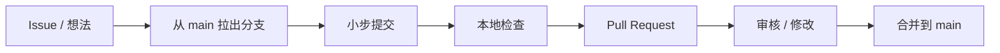

# 贡献指南

本插件只做一件事：查询 DeepSeek API 余额。提交前请阅读 [README.md](README.md) 了解行为，阅读 [DEVELOPMENT.md](DEVELOPMENT.md) 了解架构。

## 受理范围

| 欢迎 | 通常拒绝 |
| --- | --- |
| 修复错误分类、异常处理、返回结构 | 定时查询、告警、历史、数据库 |
| 补充离线测试 | 多 Key、多 Provider、其他服务商 |
| 修正文档与兼容性问题 | 聊天命令、面板、MCP、固定文案 |
| 改进 Key 脱敏与日志安全 | 新运行时依赖、自动补路径/重定向/重试 |

超出范围的想法请先开 Issue 说明场景，再决定是否实现。

## 流程



分支名建议 `fix/redirect-error`、`test/timeout-boundary`、`docs/e2e-notes`。

提交信息使用 [Conventional Commits](https://www.conventionalcommits.org/zh-hans/)：

| 前缀 | 用途 | 示例 |
| --- | --- | --- |
| `feat` | 新能力（先确认范围） | `feat(http): classify 408 as timeout` |
| `fix` | 修复缺陷 | `fix(client): avoid key in DNS errors` |
| `test` | 只改测试 | `test(e2e): assert currency set equality` |
| `docs` | 只改文档 | `docs(readme): clarify full URL` |
| `refactor` | 不改行为 | `refactor(service): extract result builder` |
| `chore` | 构建/发布 | `chore(release): bump version to 0.2.0` |

## 检查矩阵

| 检查 | 命令 |
| --- | --- |
| 单元测试 | `uv run python -m unittest discover -s tests -v` |
| 静态检查 | `uv run ruff check .` |
| 格式检查 | `uv run ruff format --check .` |

按改动追加验证：

| 改动 | 追加要求 |
| --- | --- |
| 工具描述 | 同步 `tests/balance_fixtures.py` 的 `TOOL_DESCRIPTION` |
| 请求逻辑 / 错误分类 | 补对应单元测试 |
| 配置项 | 同步 `_conf_schema.json`、`SettingsReader`、README 与测试 |
| 打包文件 | 构建 ZIP 并用 `_PluginUpdater.inspect_plugin_archive()` 校验 |
| E2E 流程 | 运行 `tests/e2e_real_astrbot.py` |

E2E 需要 `.env` 中的真实 Key，会消耗少量余额；不是每位贡献者都必须运行。PR 中请如实写明跑过和没跑的测试，不要用推测代替结果。

## 安全红线

- 不提交 `.env`；`.env.example` 只放占位符。
- 代码、测试、文档、Issue、PR、提交信息中都不得出现真实 Key。
- 新增日志不得包含 Key、完整响应体或余额明细。
- 新增错误分支必须经过 `SecretRedactor`，并通过 `ToolResult.failure()` 返回。
- E2E `--keep` 目录含真实 Key，排查后立即删除。
- Key 一旦出现在对话、日志或截图中，立即到 DeepSeek 控制台轮换。

提交前检查：

```bash
git status
git diff --cached
```

## PR 自查

- [ ] 单一目的，没有夹带无关重构
- [ ] 行为改动有对应测试
- [ ] 三项本地检查通过
- [ ] 没有 `.env`、真实 Key、缓存或临时文件
- [ ] README / DEVELOPMENT 已同步（如适用）
- [ ] PR 描述写清问题、方案、实测结果与影响面

维护者可能要求拆分过大的 PR，或拒绝超出范围的改动。

## 发布与许可

版本号在 `metadata.yaml`，遵循语义化版本；打标签、发布 Release 由维护者执行。提交贡献即表示同意以 [MIT License](LICENSE) 授权。