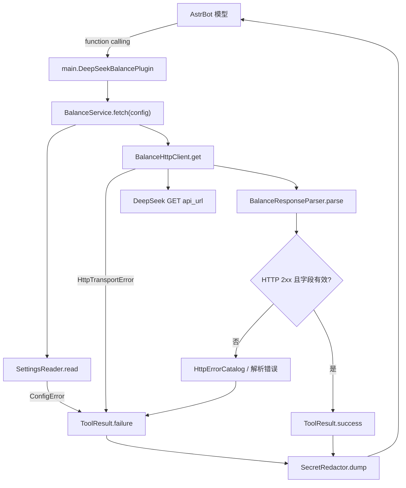
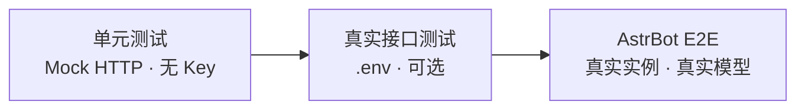
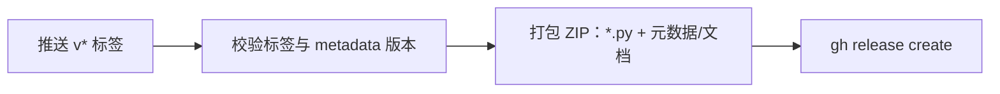

# 开发指南

面向修改、调试或扩展插件的开发者。用户安装见 [README.md](README.md)，提交规范见 [CONTRIBUTING.md](CONTRIBUTING.md)。

## 架构



| 模块 | 职责 |
| --- | --- |
| `main.py` | 插件类、工具注册、依赖组装 |
| `balance_service.py` | 编排配置读取、请求、解析与结果转换 |
| `settings_reader.py` | 校验 `api_url` / `api_key` |
| `balance_http_client.py` | 发起 GET，映射传输异常 |
| `balance_response.py` | JSON 解析与余额结构校验 |
| `http_errors.py` | HTTP 状态码到错误类型的映射 |
| `tool_result.py` | 统一成功/失败 JSON |
| `secret_redactor.py` | Key 脱敏、序列化、body 截断 |

## 硬约束

- 插件以 `data.plugins.<目录名>.main` 加载，同目录模块必须用相对导入。
- 不新增运行时依赖；`aiohttp` 由 AstrBot 提供。
- 配置项只允许 `api_url` 与 `api_key`。
- URL 原样使用，不补路径、不跟随重定向、不重试。
- docstring 即模型看到的工具描述；修改后同步 `tests/balance_fixtures.py`。
- 工具内部失败必须转为 `ToolResult.failure()`，不向 AstrBot 抛未捕获异常。

## 工具契约

- 名称：`deepseek_balance_fetch`，无参数。
- 成功：`{ok, http_status, data}`，`data` 保留接口原始业务字段。
- 失败：`{ok, error: {type, message, ...}}`；非 JSON 响应附带 `body_preview`（≤300 字符）与 `content_type`。
- 所有输出经 `SecretRedactor`，Key 不得出现在日志或返回值中。
- 完整错误类型见 [README 错误处理](README.md#错误处理)。

## 测试



| 层 | 文件 | 验证内容 |
| --- | --- | --- |
| 单元 | `tests/test_balance_*.py`、`test_tool_registration.py` | 返回结构、错误分类、URL/Key 校验、超时、注册信息 |
| 单元 | `tests/test_assistant_report.py` | E2E 报告解析与交叉校验 |
| 真实接口 | `tests/test_real_api.py` | DeepSeek HTTP 契约；无 Key 自动跳过 |
| E2E | `tests/e2e_real_astrbot.py` | 插件加载、模型调用、WebChat 回复、报告比对 |

常用命令：

```bash
uv venv --python 3.12
uv pip install astrbot ruff
uv run python -m unittest discover -s tests -v
uv run ruff check .
uv run ruff format --check .
```

E2E 需要 `.env`（模板见 `.env.example`），会启动临时 AstrBot、安装插件、通过 WebSocket 发送结构化提示词，再把模型 JSON 报告与服务器日志中的真实工具结果比对：

| 断言 | 口径 |
| --- | --- |
| `saw_tool` / `called_tool` / `tool_succeeded` | 必须为 `true` |
| 服务器日志 | 必须存在工具结果且 `ok=true` |
| `is_available` | 与真实结果一致 |
| 币种集合 | 与真实结果一致 |
| 三类金额 | 按数值比较（`110` = `110.00`） |
| `evaluation` / `reason` | 仅要求非空，内容不断言 |

`--keep` 保留临时实例，目录含真实 Key；`evaluation`/`reason` 只输出。E2E 依赖真实模型按格式输出 JSON，这是有意为之。

## 调试

| 现象 | 原因 | 处理 |
| --- | --- | --- |
| 加载失败，找不到模块 | 只复制了 `main.py` | 复制根目录全部 `*.py` |
| 工具未出现 | 插件未激活或版本过低 | 检查 `activated` 与 `astrbot_version` |
| `config_error` | URL/Key 为空或 URL 无 scheme | 补全配置 |
| `endpoint_not_found` | URL 少了 `/user/balance` | 使用完整地址 |
| `redirect_error` | 接口返回 3xx | 改为最终地址 |
| E2E 登录 401 | 使用了 `/api/login` | 改用 `/api/v1/auth/login` |
| E2E 无回复 | 使用了 `/api/v1/live-chat/ws` | 改用 `/api/v1/unified-chat/ws` |

## 打包与发布



ZIP 顶层为 `astrbot_plugin_deepseek_balance/`，不包含 `tests/`、`.env`、缓存。Git Bash 无 `zip` 时可用 Python `zipfile` 构建，再用 `_PluginUpdater.inspect_plugin_archive()` 校验。推送标签属于共享操作，需维护者授权。

## 已知限制

- 仅适配 DeepSeek `GET /user/balance` 响应结构。
- 未在长期运行实例、其他平台适配器或 Docker 部署中验证。
- `saw_tool` 是模型自述，服务端通过日志中的真实工具结果做交叉证据。