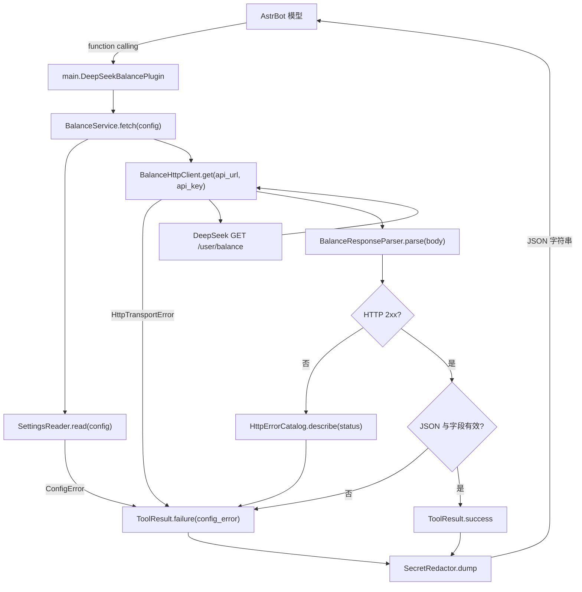

# 开发指南

本文面向需要修改、调试或扩展本插件的开发者。用户安装与配置说明见 [README.md](README.md)；提交代码前请同时阅读 [CONTRIBUTING.md](CONTRIBUTING.md)。

## 1. 项目定位

本插件只做一件事：向 AstrBot 的模型暴露一个无参数 Agent Tool `deepseek_balance_fetch`，查询 DeepSeek API 账户余额。

明确不做：

- 定时查询、余额告警、历史记录、数据库
- 多 Key、多 Provider、多服务商适配
- Dashboard、聊天命令、MCP、固定回复文案
- HTTP 重定向跟随、自动重试、代理配置

新增功能前请先确认它属于“查询余额”这一核心职责，否则应另建插件。保持范围克制是本项目最重要的设计约束之一。

## 2. 技术栈与兼容性

| 项目 | 说明 |
| --- | --- |
| 运行平台 | AstrBot `>=4.29.0`（实际验证 4.29.4） |
| Python | 3.12（实际测试 3.12.15） |
| 异步 HTTP | `aiohttp`，由 AstrBot 提供 |
| 测试框架 | 标准库 `unittest`，不引入 pytest |
| 静态检查 | `ruff check` / `ruff format` |
| 依赖文件 | 无 `requirements.txt`，避免重复安装 AstrBot 自带依赖 |

插件以 `data.plugins.<插件目录名>.main` 的形式被 AstrBot 导入。插件目录是命名空间包，因此同目录模块必须使用相对导入：

```python
from .balance_service import BalanceService
```

不要写成 `from balance_service import BalanceService`。AstrBot 只把插件目录作为包的一部加载，并不会把插件目录本身加入 `sys.path`。

## 3. 目录结构

```text
astrbot_plugin_deepseek_balance/
├── main.py                  # 插件类、工具注册、依赖组装
├── balance_service.py       # 查询流程编排
├── balance_http_client.py   # HTTP 请求与传输异常
├── balance_response.py      # JSON 解析与余额结构校验
├── settings_reader.py       # 插件配置读取与校验
├── tool_result.py           # 成功/失败 JSON 结构
├── secret_redactor.py       # Key 脱敏与响应体预览
├── http_errors.py           # HTTP 状态码到错误类型的映射
├── _conf_schema.json        # AstrBot 插件配置 Schema（仅两项）
├── metadata.yaml            # 插件元数据与版本号
├── tests/                   # 单元、真实接口、E2E 测试
├── .github/workflows/
│   └── release.yml          # 标签触发的 ZIP 打包与 Release
├── README.md                # 用户文档
├── DEVELOPMENT.md           # 本文
├── CONTRIBUTING.md          # 贡献指南
├── worklog.md               # 分阶段开发与验证记录
├── LICENSE                  # MIT
└── .env.example             # 本地测试环境变量模板
```

`__pycache__/`、`.venv/`、`.ruff_cache/`、`data/`、`.env` 均为本地生成或敏感文件，不提交。

## 4. 架构与请求流程

### 4.1 模块职责

| 模块 | 核心类型 | 职责 | 不负责 |
| --- | --- | --- | --- |
| `main.py` | `DeepSeekBalancePlugin` | 继承 `Star`，注册工具，组装服务 | 具体请求与解析 |
| `balance_service.py` | `BalanceService` | 串联配置、请求、解析、结果转换 | 直接操作 aiohttp |
| `settings_reader.py` | `SettingsReader`、`PluginSettings`、`ConfigError` | 读取并校验 `api_url` / `api_key` | 发起网络请求 |
| `balance_http_client.py` | `BalanceHttpClient`、`HttpResponse`、`HttpTransportError` | 发起 GET，捕获传输异常 | 判断业务响应 |
| `balance_response.py` | `BalanceResponseParser` | JSON 解析、业务错误与余额结构判断 | 生成工具返回值 |
| `http_errors.py` | `HttpErrorCatalog`、`HttpErrorDetail` | 非 2xx 状态码映射 | 记录日志 |
| `tool_result.py` | `ToolResult` | 构造统一的成功/失败 JSON | 决定错误类型 |
| `secret_redactor.py` | `SecretRedactor` | Key 脱敏、JSON 序列化、body 截断 | 业务判断 |

### 4.2 调用链



### 4.3 生命周期

- AstrBot 加载插件时创建一次 `DeepSeekBalancePlugin`，构造 `BalanceHttpClient`、`SettingsReader` 和 `BalanceService`。
- 每次工具调用都会重新读取 `self.config`，因此修改插件配置后无需重载插件即可生效（以 AstrBot 的配置对象更新为前提）。
- 每次请求创建独立的 `aiohttp.ClientSession`，通过 `async with` 确保连接释放。
- 插件不保存余额、不缓存结果。

## 5. 工具契约

### 5.1 注册方式

```python
@filter.llm_tool(name="deepseek_balance_fetch")
async def deepseek_balance_fetch(self, event: AstrMessageEvent) -> str:
    """查询当前配置的 DeepSeek API 账户余额……"""
    return await self._service.fetch(self.config)
```

- 工具名固定为 `deepseek_balance_fetch`。
- 方法没有除 `self` / `event` 之外的参数，因此 AstrBot 生成的工具参数为空对象 `{"type": "object", "properties": {}}`。
- **docstring 就是模型看到的工具描述**，修改时必须同步更新 `tests/balance_fixtures.py` 中的 `TOOL_DESCRIPTION`。
- 模型根据描述自主决定是否调用，插件不解析用户消息。

### 5.2 成功返回

```json
{
  "ok": true,
  "http_status": 200,
  "data": {
    "is_available": true,
    "balance_infos": [
      {
        "currency": "CNY",
        "total_balance": "110.00",
        "granted_balance": "10.00",
        "topped_up_balance": "100.00"
      }
    ]
  }
}
```

`data` 保留接口原始业务字段，不做金额换算、不排序、不裁剪（除 Key 脱敏外）。

### 5.3 失败返回

```json
{
  "ok": false,
  "error": {
    "type": "auth_error",
    "message": "API 认证失败（HTTP 401），请检查 API Key 是否正确以及是否有访问权限。",
    "http_status": 401,
    "response": { "error": { "message": "Authentication Fails" } }
  }
}
```

- 非 JSON 响应会附带截断到 300 字符的 `body_preview` 和 `content_type`。
- 错误类型完整列表见 [README 的错误处理](README.md#错误处理)。
- 任何失败都不会返回“余额为 0”或空对象冒充成功。

### 5.4 日志与脱敏

- 传输失败与非 2xx 响应会写一条 `warning`，只包含错误类别/HTTP 状态，不包含 Key。
- 所有最终 JSON 都经过 `SecretRedactor.dump()`，Key 长度 `>= 8` 且出现在文本中时替换为 `***`。
- `body_preview` 先截断再脱敏；不要在日志里直接打印响应体。
- 新增错误分支时，必须把 `redactor` 传给 `ToolResult.failure()`。

## 6. 配置系统

`_conf_schema.json` 只允许两个配置项，这是硬约束：

| 配置项 | 类型 | 行为 |
| --- | --- | --- |
| `api_url` | `string` | 去掉首尾空白后**原样**使用，必须是带 `http://` / `https://` 的完整 URL |
| `api_key` | `string`，`secret: true` | 生成 `Authorization: Bearer <key>` |

AstrBot 的插件配置文件位置：

```text
<ASTRBOT_ROOT>/data/config/<插件目录名>_config.json
```

插件安装目录：

```text
<ASTRBOT_ROOT>/data/plugins/<插件目录名>/
```

`SettingsReader` 的校验顺序：

1. `api_url` 为空 → `config_error`
2. `api_key` 为空 → `config_error`
3. URL 解析失败、scheme 不是 `http`/`https`、缺少主机名 → `config_error`

注意：即使 `api_url` 只写到域名（缺少 `/user/balance`），插件也**不会**自动补全路径。

## 7. 本地开发环境

### 7.1 创建环境

```bash
uv venv --python 3.12
uv pip install astrbot ruff
```

项目没有 `requirements.txt`。运行时只需要 AstrBot 已提供的 `aiohttp`；开发时额外使用 `ruff`。

### 7.2 运行测试

```bash
uv run python -m unittest discover -s tests -v
uv run ruff check .
uv run ruff format --check .
```

### 7.3 真实测试凭据

复制模板并填写自己的 Key：

```bash
cp .env.example .env
```

`.env` 内容：

```dotenv
DEEPSEEK_TEST_API_KEY=sk-你的测试Key
DEEPSEEK_TEST_API_URL=https://api.deepseek.com/user/balance
```

`.env` 已被 `.gitignore` 忽略。任何情况下都不要把真实 Key 写入代码、README、worklog、测试快照、Issue 或 PR。

### 7.4 在本地 AstrBot 中加载插件

手工验证时，把仓库根目录的**全部 `*.py`**、`metadata.yaml`、`_conf_schema.json` 复制到：

```text
<ASTRBOT_ROOT>/data/plugins/astrbot_plugin_deepseek_balance/
```

再在 WebUI 插件配置页填写 `api_url` 与 `api_key`。只复制 `main.py` 会因缺少相对导入的模块而加载失败。

## 8. 测试体系

测试分三层，互相补充，不要用低层测试冒充高层验证。

### 8.1 单元测试（无网络、无 Key）

文件：

| 文件 | 覆盖内容 |
| --- | --- |
| `tests/test_tool_registration.py` | 工具名、描述、零参数、插件类继承 `Star` |
| `tests/test_balance_success.py` | 成功返回原始数据、Authorization 头、路径不被改写、空余额有效 |
| `tests/test_balance_http_errors.py` | 401/403/404/429/5xx/418/302、错误体脱敏 |
| `tests/test_balance_payloads.py` | 非 JSON、空响应、不可解码字节、字段缺失、非对象 JSON、业务错误 |
| `tests/test_balance_transport.py` | 超时、连接被拒绝 |
| `tests/test_balance_config.py` | URL/Key 缺失、缺少 scheme、非 http(s) scheme |
| `tests/test_assistant_report.py` | E2E 模型 JSON 解析与交叉校验逻辑 |

支撑模块：

- `plugin_loader.py`：设置临时 `ASTRBOT_ROOT`，把仓库父目录加入 `sys.path`，以包形式导入插件模块。
- `balance_fixtures.py`：固定测试 Key、工具描述、示例余额。
- `balance_mock_server.py`：在 `127.0.0.1:0` 启动 `aiohttp` Mock 服务，自动注册清理。
- `tool_harness.py`：构造插件、调用工具、解析 JSON。
- `balance_test_case.py`：统一 `setUp`，提供 `call_tool()`。
- `env_file.py`：读取 `.env`，不覆盖已存在的环境变量。

超时测试通过 patch 模块常量实现：

```python
with patch.object(http_client, "REQUEST_TIMEOUT_SECONDS", 0.2):
    ...
```

因此 `BalanceHttpClient` 在构造时读取该常量，而不是在函数定义时绑定默认值。

### 8.2 真实接口测试

`tests/test_real_api.py`：

- 读取 `.env`，未配置 `DEEPSEEK_TEST_API_KEY` 时 `skipTest`，不会让 CI 失败。
- 正常 Key：断言 `ok=true`、`is_available` 存在、`balance_infos` 为列表、返回文本不含 Key。
- 非法 Key：断言 `auth_error` 且 HTTP 401。

这层只验证 DeepSeek HTTP 契约，不验证 AstrBot 集成。

### 8.3 真实 AstrBot 端到端测试

入口：

```bash
uv run python tests/e2e_real_astrbot.py
```

流程：

1. 在系统临时目录执行 `python -m astrbot.cli init -y`。
2. 写入 `data/cmd_config.json`：DeepSeek 提供商（`deepseek-chat`，Key 用 `$DEEPSEEK_TEST_API_KEY` 环境变量引用）、默认模型、Dashboard 主机/端口。
3. 把仓库根目录全部 `*.py`、`metadata.yaml`、`_conf_schema.json` 安装到 `data/plugins/astrbot_plugin_deepseek_balance/`。
4. 写入插件配置 `data/config/astrbot_plugin_deepseek_balance_config.json`，其中包含真实 Key。
5. 启动 `astrbot.cli run`，等待日志出现 `AstrBot started.`。
6. 登录 `/api/v1/auth/login`，轮询 `/api/plugin/get` 直到插件 `activated=true`。
7. 通过 WebSocket `/api/v1/unified-chat/ws` 发送结构化提示词，等待 `end` 事件。
8. 从服务器日志提取最后一次 `Tool \`deepseek_balance_fetch\` Result:` 后的 JSON。
9. 解析助手回复中的 JSON 报告，与真实工具结果逐字段比对。

模型被要求返回的 JSON：

```json
{
  "saw_tool": true,
  "called_tool": true,
  "tool_succeeded": true,
  "is_available": true,
  "balance_infos": [
    {
      "currency": "CNY",
      "total_balance": "0.00",
      "granted_balance": "0.00",
      "topped_up_balance": "0.00"
    }
  ],
  "evaluation": "对本次查询的简短评价",
  "reason": "评价原因"
}
```

断言口径：

| 断言 | 说明 |
| --- | --- |
| `saw_tool == true` | 模型表示在工具列表中看到了余额工具 |
| `called_tool == true` | 模型表示实际调用了工具 |
| `tool_succeeded == true` | 模型表示工具调用成功 |
| 日志存在工具结果且 `ok=true` | 服务端确实执行了工具 |
| `is_available` 一致 | 模型报告与真实结果完全一致 |
| 币种集合一致 | 不多报、不少报 |
| `total_balance` / `granted_balance` / `topped_up_balance` 数值一致 | 允许 `110` 与 `110.00` 的格式差异 |
| `evaluation` / `reason` 非空 | 只输出，不断言内容 |

实现位置：

- `tests/e2e_config.py`：常量、提示词、`TestCredentials`
- `tests/astrbot_instance.py`：初始化、配置、安装、启动、停止、日志
- `tests/astrbot_dashboard.py`：登录、插件状态、WebSocket 对话
- `tests/e2e_logs.py`：日志脱敏、工具结果提取
- `tests/json_extraction.py`：从代码块/说明文字中提取 JSON
- `tests/assistant_report.py`：报告解析与交叉校验
- `tests/e2e_runner.py`：编排、断言、输出、清理

运行注意：

- E2E 会访问真实 DeepSeek 接口，需要网络与有效 Key，耗时通常 1–3 分钟。
- 默认结束会删除临时实例；`--keep` 保留现场，**目录中包含真实 Key 的插件配置**，排查后请立即删除。
- 终端会输出模型报告的余额明细与助手评价，便于人工核对；不会输出 API Key。分享执行日志前请自行判断余额信息是否敏感。
- 测试实例使用随机 Dashboard 密码，要求至少包含大写、小写和数字。
- 必须使用 `/api/v1/unified-chat/ws`；`/api/v1/live-chat/ws` 会强制 `ct=live`，聊天消息会被静默忽略。

### 8.4 新增测试的约定

- 单元测试放在 `tests/test_*.py`，继承 `unittest` 或 `unittest.IsolatedAsyncioTestCase`。
- 需要 Mock HTTP 时复用 `BalanceMockServer`，不要启动固定端口。
- 需要构造插件时复用 `BalanceToolHarness`。
- 每个测试独立启动/清理资源，不依赖执行顺序。
- 测试中使用的 Key 必须是明显的假值（如 `sk-test-key-1234567890`）。

## 9. 调试与排障

| 现象 | 可能原因 | 处理 |
| --- | --- | --- |
| 插件加载失败，提示找不到模块 | 只复制了 `main.py`，缺少同目录模块 | 复制全部 `*.py` 后重载插件 |
| 工具列表里没有 `deepseek_balance_fetch` | 插件未激活、AstrBot 版本过低 | 检查 `activated` 与 `astrbot_version` |
| `config_error` | URL/Key 为空或 URL 缺少 scheme | 填写完整 URL 与 Key |
| `endpoint_not_found` | URL 少了 `/user/balance` | 使用完整接口地址 |
| `redirect_error` | 接口返回 3xx，插件不跟随 | 改为最终地址 |
| `invalid_response` | 响应不是 `is_available` + `balance_infos` 结构 | 确认服务商与接口 |
| 超时 | 网络不可达或接口过慢 | 检查网络；当前超时固定 15 秒 |
| E2E 登录 401 | 使用了旧路径 `/api/login` | 改用 `/api/v1/auth/login` |
| E2E 一直等不到回复 | 使用了 `/api/v1/live-chat/ws` | 改用 `/api/v1/unified-chat/ws` |
| E2E 找不到工具结果 | 模型没有调用工具或日志尚未刷新 | 检查 `[5/7]` 后的回复；脚本会在读取前 flush 日志 |

排查 E2E 时的建议：

```bash
uv run python tests/e2e_real_astrbot.py --keep
```

脚本会打印已脱敏且过滤余额字段的最近 40 行服务器日志。注意 `--keep` 目录包含真实 Key。

## 10. 代码规范

- 遵循 `ruff check` 与 `ruff format`；CI 之外也应本地执行。
- 公共函数/方法写类型标注；异步函数返回 `str` 或明确类型。
- 模块保持扁平，不新增子包；新增职责时优先新建同目录小模块。
- 跨模块导入使用相对导入。
- 面向对象封装状态（客户端、解析器、结果对象），但不要为了模式而引入抽象层。
- 用户可见的错误消息使用中文；标识符、日志 key 使用英文。
- 注释只解释“为什么”，不复述代码；不要写大段 docstring。
- 错误处理原则：工具内部失败应转成 `ToolResult.failure()`，不要向 AstrBot 抛未捕获异常。
- 不打印 Key、完整响应体或余额明细到服务器日志。

## 11. 打包与发布

### 11.1 ZIP 内容

Release ZIP 顶层是单个目录 `astrbot_plugin_deepseek_balance/`，包含：

- 根目录全部 `*.py`
- `metadata.yaml`
- `_conf_schema.json`
- `README.md`
- `LICENSE`

不要把 `tests/`、`.env`、`.git/`、缓存目录打进 ZIP。

### 11.2 本地模拟 CI 打包

Git Bash 环境可能没有 `zip` 命令，可用 Python：

```python
import glob
import zipfile
from pathlib import Path

root = Path.cwd()
out = Path("astrbot_plugin_deepseek_balance-0.1.0.zip")
files = sorted(glob.glob("*.py")) + [
    "metadata.yaml",
    "_conf_schema.json",
    "README.md",
    "LICENSE",
]
with zipfile.ZipFile(out, "w", zipfile.ZIP_DEFLATED) as archive:
    for name in files:
        archive.write(root / name, f"astrbot_plugin_deepseek_balance/{name}")
```

可用 AstrBot 自带的检查器验证：

```python
from astrbot.core.star.updater import _PluginUpdater

info = _PluginUpdater.inspect_plugin_archive(
    "astrbot_plugin_deepseek_balance-0.1.0.zip"
)
print(info["metadata"])
```

### 11.3 自动发布

`.github/workflows/release.yml` 在推送 `v*` 标签时：

1. 校验标签 `v<version>` 与 `metadata.yaml` 的 `version` 完全一致。
2. 创建 `dist/astrbot_plugin_deepseek_balance/`，复制 `*.py` 与元数据/文档文件。
3. 打包 `astrbot_plugin_deepseek_balance-<version>.zip`。
4. 使用 `gh release create --verify-tag --generate-notes` 创建 Release。

发布步骤：

```bash
# 1. 修改 metadata.yaml 的 version
# 2. 更新 README / worklog（如有行为变化）
git add metadata.yaml README.md worklog.md
git commit -m "chore(release): bump version to 0.2.0"
git tag v0.2.0
git push origin main
git push origin v0.2.0
```

推送标签属于共享操作，需维护者明确授权。

## 12. 常见扩展点

### 新增错误类型

1. HTTP 状态相关：修改 `http_errors.HttpErrorCatalog.describe()`。
2. 传输相关：在 `BalanceHttpClient` 捕获对应异常并抛出带 `error_type` 的 `HttpTransportError`。
3. 响应内容相关：在 `BalanceService.fetch()` 增加分支。
4. 同步更新 README 错误表、增加单元测试。

### 修改超时

修改 `balance_http_client.REQUEST_TIMEOUT_SECONDS`，并同步 README 中“15 秒”的说明与超时测试。

### 新增配置项

需要同时修改：

- `_conf_schema.json`
- `SettingsReader`
- `README.md` 插件配置章节
- 相关单元测试

但请先确认它符合“只查询余额”的定位。配置项越少越稳定。

### 修改工具描述

修改 `main.py` 的 docstring，并同步 `tests/balance_fixtures.py` 的 `TOOL_DESCRIPTION`。描述变化会影响模型是否调用工具，建议在真实 E2E 中重新验证。

### 新增插件模块

- 放在仓库根目录，使用相对导入。
- 不要修改 CI 的复制规则：工作流已使用 `cp *.py`。
- E2E 会自动复制根目录全部 `*.py`，无需手工维护清单。
- 如果模块是测试辅助代码，放在 `tests/`，不会被复制进 ZIP。

## 13. 已知限制

- 仅适配 DeepSeek `GET /user/balance` 的响应结构。
- 不跟随重定向、不自动重试、不配置超时。
- 未在长期运行实例、其他平台适配器或 Docker 部署中做端到端验证。
- E2E 依赖真实模型输出 JSON；虽然解析器支持代码块和前后说明文字，但模型完全不按格式输出时测试会失败，这是有意为之。
- 模型自述的 `saw_tool` 无法从服务端直接证明；测试同时要求真实日志中存在工具调用结果作为交叉证据。

## 14. 安全检查清单

提交前逐项确认：

- [ ] 没有提交 `.env`、`.env.*`（`.env.example` 除外）
- [ ] 代码、测试、文档、worklog 中没有真实 Key
- [ ] 新增日志不包含 Key、完整响应体或余额明细
- [ ] 新增错误分支仍经过 `SecretRedactor`
- [ ] 分享 E2E 输出或截图前已确认不含敏感信息
- [ ] 如果 Key 曾出现在对话、日志或截图中，立即到 DeepSeek 控制台轮换