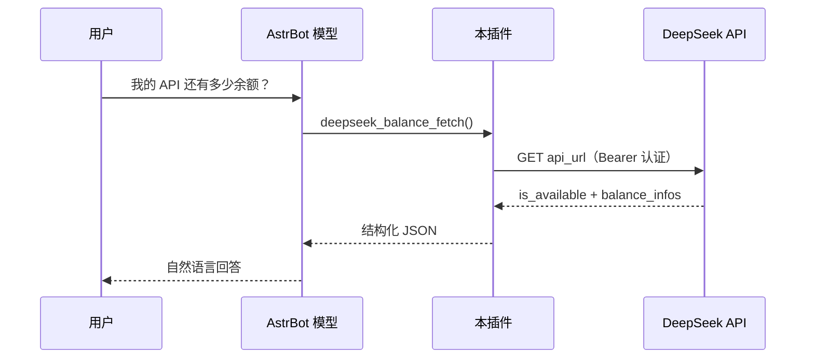
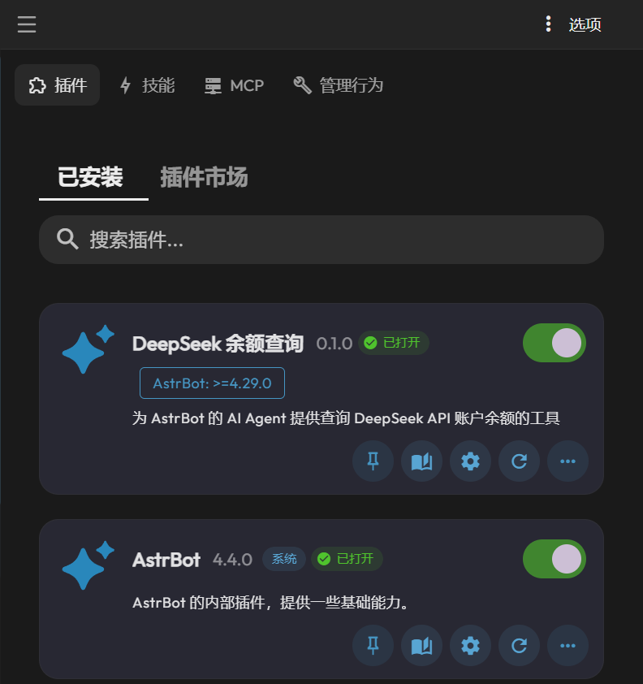
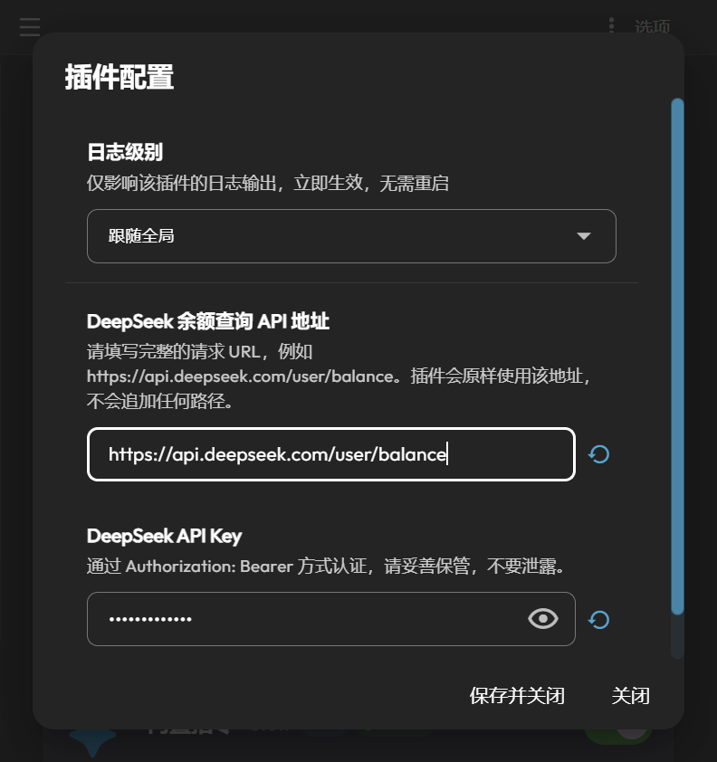
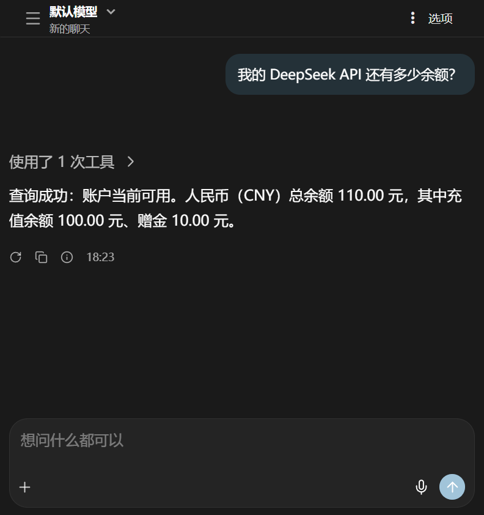

# AstrBot DeepSeek 余额查询插件

为 [AstrBot](https://github.com/AstrBotDevs/AstrBot) 提供一个无参数的余额查询工具，由模型在用户询问余额时自主调用。



## 工具

| 项目 | 内容 |
| --- | --- |
| 名称 | `deepseek_balance_fetch` |
| 参数 | 无 |
| 调用方 | 模型自主调用（function calling） |
| 返回 | JSON：成功含 `ok`、`http_status`、`data`；失败含 `ok`、`error` |

插件不解析聊天消息，也不生成固定回复。

## 界面

安装后在插件列表中显示为已打开：



插件配置只有两个输入项，API Key 以掩码显示：



模型调用工具后根据返回数据回答余额：



> 截图为演示环境，余额为示例数据。

## 配置

插件只有两个配置项：

| 配置项 | 类型 | 说明 |
| --- | --- | --- |
| `api_url` | 字符串 | 余额接口的**完整 URL**，原样使用 |
| `api_key` | Secret | 用于 `Authorization: Bearer <key>` |

URL 规则：

- 必须带 `http://` 或 `https://`，并包含完整路径。
- 正确：`https://api.deepseek.com/user/balance`
- 错误：`https://api.deepseek.com`（不会自动补 `/user/balance`）
- 插件不跟随重定向；遇到 3xx 请改为最终地址。

API Key 不会写入日志、工具返回值或错误信息。

## 返回示例

成功：

```json
{
  "ok": true,
  "http_status": 200,
  "data": {
    "is_available": true,
    "balance_infos": [
      {
        "currency": "CNY",
        "total_balance": "110.00",
        "granted_balance": "10.00",
        "topped_up_balance": "100.00"
      }
    ]
  }
}
```

失败：

```json
{
  "ok": false,
  "error": {
    "type": "auth_error",
    "message": "API 认证失败（HTTP 401），请检查 API Key 是否正确以及是否有访问权限。",
    "http_status": 401,
    "response": { "error": { "message": "Authentication Fails" } }
  }
}
```

## 安装

| 方式 | 来源 | 操作 |
| --- | --- | --- |
| 插件市场 | 官方市场 | **尚未收录**，上架后可在 WebUI 搜索安装 |
| URL 安装 | GitHub 仓库 | 在 WebUI 填 `https://github.com/msksbr515/astrbot_plugin_deepseek_balance` |
| ZIP 安装 | GitHub Releases | 下载 `astrbot_plugin_deepseek_balance-<version>.zip` 上传 |
| 手动安装 | Git Clone | 克隆到 `<ASTRBOT_ROOT>/data/plugins/` 后重载插件 |

ZIP 包含根目录全部 `*.py`、`metadata.yaml`、`_conf_schema.json`、`README.md`、`LICENSE`。安装后在插件配置页填写 `api_url` 与 `api_key`。

## 错误处理

所有失败都返回 `ok: false`，不会把失败当成余额为零。

| 类别 | `error.type` |
| --- | --- |
| 配置 | `config_error`、`invalid_url` |
| 网络 | `dns_error`、`connection_error`、`ssl_error`、`timeout`（15 秒）、`network_error` |
| HTTP | `auth_error`（401/403）、`endpoint_not_found`（404）、`rate_limited`（429）、`redirect_error`（3xx）、`server_error`（5xx）、`http_error` |
| 响应 | `invalid_json`、`invalid_response`、`business_error` |

JSON 错误体会放在 `error.response`；非 JSON 响应会附带截断到 300 字符的 `body_preview` 与 `content_type`。

## 兼容性

- AstrBot **>= 4.29.0**（实际验证 4.29.4），Python 3.12。
- 仅依赖 AstrBot 自带的 `aiohttp`，无 `requirements.txt`。
- 仅适配 DeepSeek `GET /user/balance` 的响应结构。
- 不跟随重定向、不自动重试、不做定时查询/告警/历史记录。

## 文档

| 文档 | 内容 |
| --- | --- |
| [DEVELOPMENT.md](DEVELOPMENT.md) | 架构、模块职责、测试体系、调试、打包发布 |
| [CONTRIBUTING.md](CONTRIBUTING.md) | 贡献流程、提交规范、测试矩阵、安全规则 |
| [worklog.md](worklog.md) | 分阶段开发与验证记录 |

## 许可证

[MIT License](LICENSE)。运行时依赖的 `aiohttp` 由 AstrBot 提供，遵循其自身许可证。